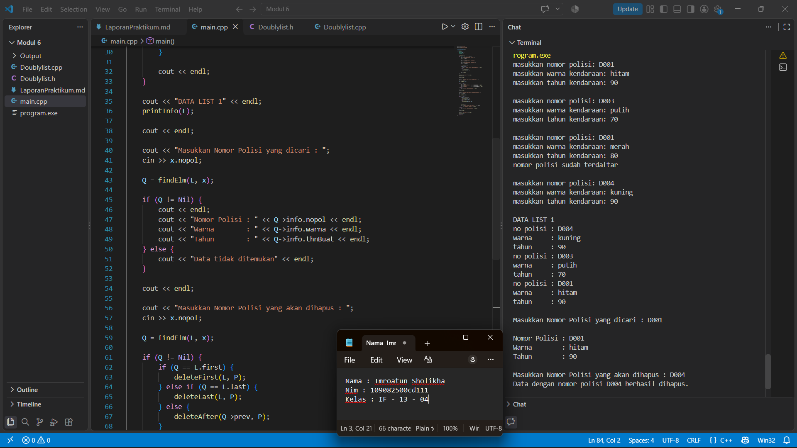
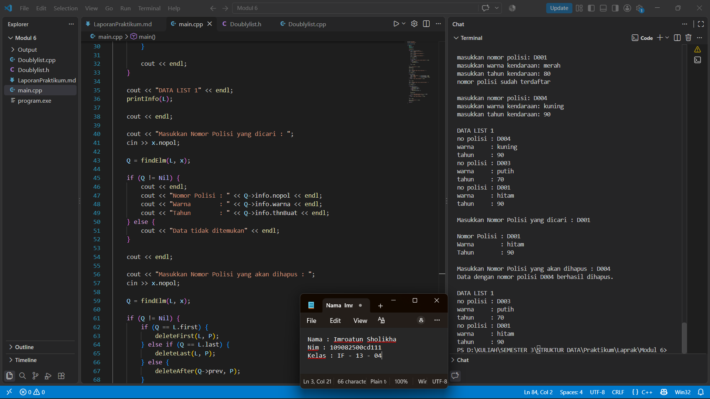

# <h1 align="center">Laporan Praktikum Modul 6 - DOUBLY LINKED LIST (BAGIAN PERTAMA) </h1>

<p align="center">Imroatun Sholikha - 109082500111</p>

Dasar Teori
Doubly Linked List merupakan struktur data yang terdiri dari sejumlah elemen atau node yang saling terhubung menggunakan pointer. Setiap node memiliki bagian info untuk menyimpan data, next untuk menunjuk ke elemen berikutnya, dan prev untuk menunjuk ke elemen sebelumnya. Adanya dua pointer tersebut memungkinkan proses penelusuran data dilakukan dari dua arah, yaitu maju dan mundur. Namun, penggunaan pointer tambahan membutuhkan ruang memori lebih besar dibandingkan Singly Linked List. [1][2]

### A. Insert

Insert merupakan operasi untuk menambahkan elemen baru ke dalam Doubly Linked List. Proses penambahan data dapat dilakukan pada posisi pertama (insertFirst), posisi terakhir (insertLast), setelah elemen tertentu (insertAfter), maupun sebelum elemen tertentu (insertBefore). Penambahan elemen dilakukan dengan mengatur hubungan pointer next dan prev agar setiap node tetap saling terhubung. [1]

### B. Delete

Delete merupakan operasi untuk menghapus elemen dari Doubly Linked List. Penghapusan data dapat dilakukan pada posisi pertama (deleteFirst), posisi terakhir (deleteLast), setelah elemen tertentu (deleteAfter), maupun sebelum elemen tertentu (deleteBefore). Proses penghapusan dilakukan dengan mengatur kembali pointer next dan prev agar hubungan antar-elemen tetap terjaga. Jika alamat node yang akan dihapus sudah diketahui, proses penghubungan ulang pointer dapat dilakukan tanpa menelusuri list dari awal. [1][2]


## Guided

### 1. 


## listMakanan.h

```C++
#ifndef LISTMAKANAN_H
#define LISTMAKANAN_H
#define Nil NULL

#include <iostream>
using namespace std;

struct makanan
{
    string nama;
    string jenis;
    float harga;
    float rating;
};

typedef makanan dataMakanan;

typedef struct node *address;

struct node
{
    dataMakanan isidata;
    address next;
    address prev;
};

struct linkedlist
{
    address first;
    address last;
};

bool isEmpty(linkedlist List);
void createList(linkedlist &List);
address alokasi(string nama, string jenis, float harga, float rating);
void dealokasi(address &node);

void insertFirst(linkedlist &List, address nodeBaru);
void insertLast(linkedlist &List, address nodeBaru);
void insertAfter(linkedlist &List, address nodeBaru, address Prev);
void insertBefore(linkedlist &List, address nodeBaru, address nodeNext);

void printList(linkedlist List);

void updateFirst(linkedlist List);
void updateLast(linkedlist List);
void updateAfter(linkedlist List, address prev);
void updateBefore(linkedlist List, address nodeNext);

// Searching
void findByName(linkedlist List, string nama);
void findByJenis(linkedlist List, string jenis);
void findByMinRating(linkedlist List, float minRating);

// Delete
void deleteFirst(linkedlist &List);
void deleteLast(linkedlist &List);
void deleteAfter(linkedlist &List, address Prev);
void deleteBefore(linkedlist &List, address nodeNext);

void deleteNode(linkedlist &List, address target);
void deleteByName(linkedlist &List, string nama);

#endif
```

## listMakanan.cpp

```C++
#include "listmakanan.h"
#include <iostream>
#include <string>
using namespace std;

bool isEmpty(linkedlist List)
{
    if (List.first == Nil)
    {
        return true;
    }
    else
    {
        return false;
    }
}

void createList(linkedlist &List)
{
    List.first = Nil;
    List.last = Nil;
}

// pembuatan node baru dengan menerapkan manajemen memori
address alokasi(string nama, string jenis, float harga, float rating)
{
    address nodeBaru = new node;
    nodeBaru->isidata.nama = nama;
    nodeBaru->isidata.jenis = jenis;
    nodeBaru->isidata.harga = harga;
    nodeBaru->isidata.rating = rating;
    nodeBaru->next = Nil;
    nodeBaru->prev = Nil;
    return nodeBaru;
}

void dealokasi(address &node)
{
    node->next = Nil;
    node->prev = Nil;
    delete node;
}

void insertFirst(linkedlist &List, address nodeBaru)
{
    if (isEmpty(List))
    {
        List.first = List.last = nodeBaru;
    }
    else
    {
        nodeBaru->next = List.first;
        List.first->prev = nodeBaru;
        List.first = nodeBaru;
    }
    cout << "Node " << nodeBaru->isidata.nama << " berhasil ditambahkan sebagai node pertama list" << endl;
}

void insertLast(linkedlist &List, address nodeBaru)
{
    if (isEmpty(List) == true)
    {
        List.first = List.last = nodeBaru;
    }
    else
    {
        nodeBaru->prev = List.last;
        List.last->next = nodeBaru;
        List.last = nodeBaru;
    }
    cout << "Node " << nodeBaru->isidata.nama << " berhasil ditambahkan sebagai node terakhir list" << endl;
}

void insertAfter(linkedlist &List, address nodeBaru, address nodePrev)
{
    if (isEmpty(List) == true)
    {
        List.first = List.last = nodeBaru;
    }
    else
    {
        if (nodePrev != Nil)
        {
            if (nodePrev == List.last) 
            {
                insertLast(List, nodeBaru);
            }
            else
            {
                nodeBaru->next = nodePrev->next;
                nodeBaru->prev = nodePrev;
                (nodePrev->next)->prev = nodeBaru;
                nodePrev->next = nodeBaru;
                cout << "Node " << nodeBaru->isidata.nama << " berhasil ditambahkan setelah node " << nodePrev->isidata.nama << endl;
            }
        }
        else
        {
            cout << "node sebelumnya (nodePrev) tidak valid!" << endl;
        }
    }
}

void insertBefore(linkedlist &List, address nodeBaru, address nodeNext)
{
    if (isEmpty(List) == true)
    {
        List.first = List.last = nodeBaru;
    }
    else
    {
        if (nodeNext != Nil)
        {
            if (nodeNext == List.first)
            {
                insertFirst(List, nodeBaru);
            }
            else
            {
                nodeBaru->next = nodeNext;
                nodeBaru->prev = nodeNext->prev;
                (nodeNext->prev)->next = nodeBaru;
                nodeNext->prev = nodeBaru;
                cout << "Node " << nodeBaru->isidata.nama << " berhasil ditambahkan sebelum node " << nodeNext->isidata.nama << endl;
            }
        }
        else
        {
            cout << "node setelahnya (nodeNext) tidak valid!" << endl;
        }
    }
}

void printList(linkedlist List)
{
    if (isEmpty(List) == true)
    {
        cout << "List kosong!" << endl;
    }
    else
    {
        address nodeBantu = List.first;
        while (nodeBantu != Nil)
        {
            cout << "Nama makanan : " << nodeBantu->isidata.nama << endl;
            cout << "Jenis        : " << nodeBantu->isidata.jenis << endl;
            cout << "Harga        : " << nodeBantu->isidata.harga << endl;
            cout << "Rating       : " << nodeBantu->isidata.rating << endl;
            cout << "-------------------------------" << endl;
            nodeBantu = nodeBantu->next;
        }
    }
}

void updateFirst(linkedlist List)
{
    if (isEmpty(List) == true)
    {
        cout << "List kosong!" << endl;
    }
    else
    {
        cout << "Masukkan update data node pertama : " << endl;
        cout << "Nama makanan : ";
        getline(cin, List.first->isidata.nama);
        cout << "Jenis makanan : ";
        getline(cin, List.first->isidata.jenis);
        cout << "Harga : ";
        cin >> List.first->isidata.harga;
        cout << "Rating : ";
        cin >> List.first->isidata.rating;
        cin.ignore(); // menghapus karakter newline (/n) dari input buffer
        cout << "Data Berhasil Diupdate!" << endl;
        cout << endl;
    }
}

void updateLast(linkedlist List)
{
    if (isEmpty(List) == true)
    {
        cout << "List kosong!" << endl;
    }
    else
    {
        cout << "Masukkan update data node terakhir : " << endl;
        cout << "Nama makanan : ";
        getline(cin, List.last->isidata.nama);
        cout << "Jenis makanan : ";
        getline(cin, List.last->isidata.jenis);
        cout << "Harga : ";
        cin >> List.last->isidata.harga;
        cout << "Rating : ";
        cin >> List.last->isidata.rating;
        cin.ignore(); // menghapus karakter newline (/n) dari input buffer
        cout << "Data Berhasil Diupdate!" << endl;
        cout << endl;
    }
}

void updateAfter(linkedlist List, address nodePrev)
{
    if (isEmpty(List) == true)
    {
        cout << "List kosong!" << endl;
    }
    else
    {
        if (nodePrev != Nil && nodePrev->next != Nil)
        {
            address nodeBantu = nodePrev->next;
            cout << "masukkan update data node setelah node " << nodePrev->isidata.nama << " : " << endl;
            cout << "Nama makanan : ";
            getline(cin, nodeBantu->isidata.nama);
            cout << "Jenis makanan : ";
            getline(cin, nodeBantu->isidata.jenis);
            cout << "Harga : ";
            cin >> nodeBantu->isidata.harga;
            cout << "Rating : ";
            cin >> nodeBantu->isidata.rating;
            cin.ignore(); // menghapus karakter newline (/n) dari input buffer
            cout << "Data Berhasil Diupdate!" << endl;
            cout << endl;
        }
        else
        {
            cout << "Node sebelumnya (nodePrev) tidak valid!" << endl;
        }
    }
}

void updateBefore(linkedlist List, address nodeNext)
{
    if (isEmpty(List) == true)
    {
        cout << "List kosong!" << endl;
    }
    else
    {
        if (nodeNext != Nil && nodeNext->prev != Nil)
        {
            address nodeBantu = nodeNext->prev;
            cout << "masukkan update data node sebelum node " << nodeNext->isidata.nama << " : " << endl;
            cout << "Nama makanan : ";
            getline(cin, nodeBantu->isidata.nama);
            cout << "Jenis makanan : ";
            getline(cin, nodeBantu->isidata.jenis);
            cout << "Harga : ";
            cin >> nodeBantu->isidata.harga;
            cout << "Rating : ";
            cin >> nodeBantu->isidata.rating;
            cin.ignore(); // menghapus karakter newline (/n) dari input buffer
            cout << "Data Berhasil Diupdate!" << endl;
            cout << endl;
        }
        else
        {
            cout << "Node sebelumnya (prev) tidak valid!" << endl;
        }
    }
}

// SEARCHING
void findByName(linkedlist List, string nama)
{
    if (isEmpty(List))
    {
        cout << "List kosong!" << endl;
        return;
    }
    address p = List.first;
    while (p != Nil)
    {
        if (p->isidata.nama == nama)
        {
            cout << "Ditemukan (berdasarkan nama):" << endl;
            cout << "Nama makanan : " << p->isidata.nama << endl;
            cout << "Jenis        : " << p->isidata.jenis << endl;
            cout << "Harga        : " << p->isidata.harga << endl;
            cout << "Rating       : " << p->isidata.rating << endl;
            return;
        }
        p = p->next;
    }
    cout << "Data dengan nama \"" << nama << "\" tidak ditemukan." << endl;
}

void findByJenis(linkedlist List, string jenis)
{
    if (isEmpty(List))
    {
        cout << "List kosong!" << endl;
        return;
    }
    address p = List.last;
    while (p != Nil)
    {
        if (p->isidata.jenis == jenis)
        {
            cout << "Ditemukan (berdasarkan jenis):" << endl;
            cout << "Nama makanan : " << p->isidata.nama << endl;
            cout << "Jenis        : " << p->isidata.jenis << endl;
            cout << "Harga        : " << p->isidata.harga << endl;
            cout << "Rating       : " << p->isidata.rating << endl;
            return;
        }
        p = p->prev;
    }
    cout << "Data dengan jenis \"" << jenis << "\" tidak ditemukan." << endl;
}

void findByMinRating(linkedlist List, float minRating)
{
    if (isEmpty(List))
    {
        cout << "List kosong!" << endl;
        return;
    }
    address p = List.last;
    while (p != Nil)
    {
        if (p->isidata.rating >= minRating)
        {
            cout << "Ditemukan (rating >= " << minRating << "):" << endl;
            cout << "Nama makanan : " << p->isidata.nama << endl;
            cout << "Jenis        : " << p->isidata.jenis << endl;
            cout << "Harga        : " << p->isidata.harga << endl;
            cout << "Rating       : " << p->isidata.rating << endl;
            return;
        }
        p = p->prev;
    }
    cout << "Tidak ada data dengan rating >= " << minRating << "." << endl;
}

// DELETE
void deleteFirst(linkedlist &List)
{
    if (isEmpty(List) == true)
    {
        cout << "List kosong! Tidak ada node yang dihapus." << endl;
        return;
    }
    address pDel = List.first;
    if (List.first == List.last)
    {
        List.first = List.last = Nil;
    }
    else
    {
        List.first = pDel->next;
        List.first->prev = Nil;
        pDel->next = Nil;
    }
    pDel->prev = Nil;
    cout << "Node " << pDel->isidata.nama << " berhasil dihapus dari posisi pertama." << endl;
    dealokasi(pDel);
}

void deleteLast(linkedlist &List)
{
    if (isEmpty(List) == true)
    {
        cout << "List kosong! Tidak ada node yang dihapus." << endl;
        return;
    }
    address pDel = List.last;
    if (List.first == List.last)
    {
        List.first = List.last = Nil;
    }
    else
    {
        List.last = pDel->prev;
        List.last->next = Nil;
        pDel->prev = Nil;
    }
    pDel->next = Nil;
    cout << "Node " << pDel->isidata.nama << " berhasil dihapus dari posisi terakhir." << endl;
    dealokasi(pDel);
}

void deleteAfter(linkedlist &List, address Prev)
{
    if (isEmpty(List) == true)
    {
        cout << "List kosong! Tidak ada node yang dihapus." << endl;
        return;
    }
    if (Prev == Nil || Prev->next == Nil)
    {
        cout << "Node sebelumnya (Prev) tidak valid atau tidak ada node setelahnya!" << endl;
        return;
    }
    if (Prev->next == List.last)
    {
        deleteLast(List);
        return;
    }
    address pDel = Prev->next;
    Prev->next = pDel->next;
    pDel->next->prev = Prev;
    pDel->next = Nil;
    pDel->prev = Nil;
    cout << "Node " << pDel->isidata.nama << " berhasil dihapus setelah node " << Prev->isidata.nama << "." << endl;
    dealokasi(pDel);
}

void deleteBefore(linkedlist &List, address nodeNext)
{
    if (isEmpty(List) == true)
    {
        cout << "List kosong! Tidak ada node yang dihapus." << endl;
        return;
    }
    if (nodeNext == Nil || nodeNext->prev == Nil)
    {
        cout << "Node setelahnya (nodeNext) tidak valid atau tidak ada node sebelumnya!" << endl;
        return;
    }
    if (nodeNext->prev == List.first)
    {
        deleteFirst(List);
        return;
    }
    address pDel = nodeNext->prev;
    nodeNext->prev = pDel->prev;
    pDel->prev->next = nodeNext;
    pDel->next = Nil;
    pDel->prev = Nil;
    cout << "Node " << pDel->isidata.nama << " berhasil dihapus sebelum node " << nodeNext->isidata.nama << "." << endl;
    dealokasi(pDel);
}

void deleteNode(linkedlist &List, address target)
{
    if (isEmpty(List) == true || target == Nil)
    {
        cout << "Target tidak valid atau list kosong!" << endl;
        return;
    }
    if (target == List.first)
    {
        deleteFirst(List);
    }
    else if (target == List.last)
    {
        deleteLast(List);
    }
    else
    {
        address L = target->next;
        address R = target->prev;
        R->next = L;
        L->prev = R;
        target->next = Nil;
        target->prev = Nil;
        cout << "Node " << target->isidata.nama << " berhasil dihapus dari tengah list." << endl;
        dealokasi(target);
    }
}

void deleteByName(linkedlist &List, string nama)
{
    if (isEmpty(List))
    {
        cout << "List kosong! Tidak ada node yang dihapus." << endl;
        return;
    }

    address target = List.first;
    while (target != Nil && target->isidata.nama != nama)
    {
        target = target->next;
    }
    if (target == Nil)
    {
        cout << "Node dengan nama \"" << nama << "\" tidak ditemukan." << endl;
        return;
    }

    deleteNode(List, target);
    cout << "Node dengan nama \"" << nama << "\" telah dihapus dan didealokasi." << endl;
}
```

## main.cpp

```C++
#include "listMakanan.h"
#include <iostream>

using namespace std;

int main()
{
    linkedlist List;
    address nodeA, nodeB, nodeC, nodeD, nodeE = Nil;
    createList(List);

    dataMakanan dtMakanan;

    nodeA = alokasi("Nasi Rames", "Makanan Berat", 10000, 8.5);
    nodeB = alokasi("Ayam Geprek", "Makanan Berat", 13000, 9.0);
    nodeC = alokasi("Risol Mayo", "Makanan Ringan", 3500, 8.8);
    nodeD = alokasi("Mie Ayam", "Makanan Berat", 15000, 9.9);
    nodeE = alokasi("Donat", "Makanan Ringan", 2000, 7.7);

    insertFirst(List, nodeD);
    insertLast(List, nodeE);
    insertAfter(List, nodeA, nodeD);
    insertBefore(List, nodeC, nodeE);
    insertLast(List, nodeB);
    cout << endl;

    // D - A - C - E - B
    cout << "--- Isi List Setelah Insert ---" << endl;
    printList(List);
    cout << endl;

    updateFirst(List);
    updateLast(List);
    updateBefore(List, nodeC);
    updateAfter(List, nodeA);

    cout << "--- Isi List Setelah Update ---" << endl;
    printList(List);

    cout << endl;

    findByName(List, "Nasgor");
    findByMinRating(List, 9.0);

    deleteByName(List, "Nasgor");
    deleteFirst(List);
    deleteBefore(List, nodeE);

    cout << endl
         << "--- Isi List Setelah Delete ---" << endl;
    printList(List);

    return 0;
}
```

## Unguided

### 1. Buatlah ADT Singly Linked list sebagai berikut di dalam file “Doublylist”:

## Doublylist.h

```C++

#ifndef DOUBLYLIST_H
#define DOUBLYLIST_H

#include <iostream>
#include <string>
using namespace std;

#define Nil NULL

struct kendaraan {
    string nopol;
    string warna;
    int thnBuat;
};

typedef kendaraan infotype;
typedef struct elmlist *address;

struct elmlist {
    infotype info;
    address next;
    address prev;
};

struct list {
    address first;
    address last;
};

void CreateList(list &L);
address alokasi(infotype x);
void dealokasi(address &P);
void printInfo(list L);
void insertFirst(list &L, address P);
void insertLast(list &L, address P);
address findElm(list L, infotype x);
void deleteFirst(list &L, address &P);
void deleteLast(list &L, address &P);
void deleteAfter(address Prec, address &P);

#endif

```
Pada kode ini terdapat deklarasi data kendaraan yang berisi nomor polisi, warna, dan tahun pembuatan. Selain itu, terdapat pointer next dan prev untuk menghubungkan setiap elemen, serta deklarasi fungsi yang digunakan untuk mengolah data. 

## Doublylist.cpp

```C++

#include "Doublylist.h"

void CreateList(list &L) {
    L.first = Nil;
    L.last = Nil;
}

address alokasi(infotype x) {
    address P = new elmlist;
    P->info = x;
    P->next = Nil;
    P->prev = Nil;
    return P;
}

void dealokasi(address &P) {
    delete P;
    P = Nil;
}

void printInfo(list L) {
    address P = L.first;

    while (P != Nil) {
        cout << "no polisi : " << P->info.nopol << endl;
        cout << "warna     : " << P->info.warna << endl;
        cout << "tahun     : " << P->info.thnBuat << endl;

        P = P->next;
    }
}

void insertFirst(list &L, address P) {
    if (L.first == Nil) {
        L.first = P;
        L.last = P;
    } else {
        P->next = L.first;
        L.first->prev = P;
        L.first = P;
    }
}

void insertLast(list &L, address P) {
    if (L.first == Nil) {
        L.first = P;
        L.last = P;
    } else {
        P->prev = L.last;
        L.last->next = P;
        L.last = P;
    }
}

address findElm(list L, infotype x) {
    address P = L.first;

    while (P != Nil) {
        if (P->info.nopol == x.nopol) {
            return P;
        }

        P = P->next;
    }

    return Nil;
}

void deleteFirst(list &L, address &P) {
    P = L.first;

    if (P != Nil) {
        if (L.first == L.last) {
            L.first = Nil;
            L.last = Nil;
        } else {
            L.first = P->next;
            L.first->prev = Nil;
        }

        P->next = Nil;
        P->prev = Nil;
    }
}

void deleteLast(list &L, address &P) {
    P = L.last;

    if (P != Nil) {
        if (L.first == L.last) {
            L.first = Nil;
            L.last = Nil;
        } else {
            L.last = P->prev;
            L.last->next = Nil;
        }

        P->next = Nil;
        P->prev = Nil;
    }
}

void deleteAfter(address Prec, address &P) {
    if (Prec != Nil && Prec->next != Nil) {
        P = Prec->next;

        Prec->next = P->next;

        if (P->next != Nil) {
            P->next->prev = Prec;
        }

        P->next = Nil;
        P->prev = Nil;
    }
}
```
Kode ini berisi fungsi untuk membuat list, mengalokasikan dan menghapus memori, serta menampilkan data kendaraan. Penambahan data dilakukan menggunakan insertFirst() dan insertLast(). Selain itu, terdapat fungsi findElm() untuk mencari kendaraan dan fungsi delete untuk menghapus data dari list.

## main.cpp

```C++
#include <iostream>
#include "Doublylist.h"

using namespace std;

int main() {
    list L;
    address P, Q;
    infotype x;

    CreateList(L);

    for (int i = 1; i <= 4; i++) {
        cout << "masukkan nomor polisi: ";
        cin >> x.nopol;

        cout << "masukkan warna kendaraan: ";
        cin >> x.warna;

        cout << "masukkan tahun kendaraan: ";
        cin >> x.thnBuat;

        Q = findElm(L, x);

        if (Q != Nil) {
            cout << "nomor polisi sudah terdaftar" << endl;
        } else {
            P = alokasi(x);
            insertFirst(L, P);
        }

        cout << endl;
    }

    cout << "DATA LIST 1" << endl;
    printInfo(L);

    cout << endl;

    cout << "Masukkan Nomor Polisi yang dicari : ";
    cin >> x.nopol;

    Q = findElm(L, x);

    if (Q != Nil) {
        cout << endl;
        cout << "Nomor Polisi : " << Q->info.nopol << endl;
        cout << "Warna        : " << Q->info.warna << endl;
        cout << "Tahun        : " << Q->info.thnBuat << endl;
    } else {
        cout << "Data tidak ditemukan" << endl;
    }

    cout << endl;

    cout << "Masukkan Nomor Polisi yang akan dihapus : ";
    cin >> x.nopol;

    Q = findElm(L, x);

    if (Q != Nil) {
        if (Q == L.first) {
            deleteFirst(L, P);
        } else if (Q == L.last) {
            deleteLast(L, P);
        } else {
            deleteAfter(Q->prev, P);
        }

        dealokasi(P);

        cout << "Data dengan nomor polisi " << x.nopol
             << " berhasil dihapus." << endl;
    } else {
        cout << "Data tidak ditemukan." << endl;
    }

    cout << endl;

    cout << "DATA LIST 1" << endl;
    printInfo(L);

    return 0;
}

```
Program dijalankan dengan memasukkan empat data kendaraan melalui terminal. Jika nomor polisi sudah terdaftar, data tidak akan dimasukkan kembali. Selanjutnya dilakukan penampilan data, pencarian kendaraan berdasarkan nomor polisi D001, dan penghapusan kendaraan D003. Setelah penghapusan, program menampilkan kembali data kendaraan yang tersisa.

### Output Unguided 1 :

##### Output 1



##### Output 2



## Kesimpulan

Program Doubly Linked List dapat digunakan untuk menyimpan dan menampilkan data kendaraan, mencari kendaraan berdasarkan nomor polisi, serta menghapus data kendaraan tertentu. Hasil pengujian menunjukkan bahwa kendaraan dengan nomor polisi D001 berhasil ditemukan, sedangkan kendaraan D003 berhasil dihapus dari list. Setelah penghapusan, data yang tersisa adalah D001, D002, dan D004.

## Referensi

[1] Fakultas Informatika, Telkom University, “Modul 6: Doubly linked list (bagian pertama),” dalam Modul Praktikum Struktur Data, Bandung, Indonesia: Telkom University, 2026.

[2] Coddy. (2026). Doubly Linked List. https://coddy.tech/visualize/id/data-structures/doubly-linked-list.
